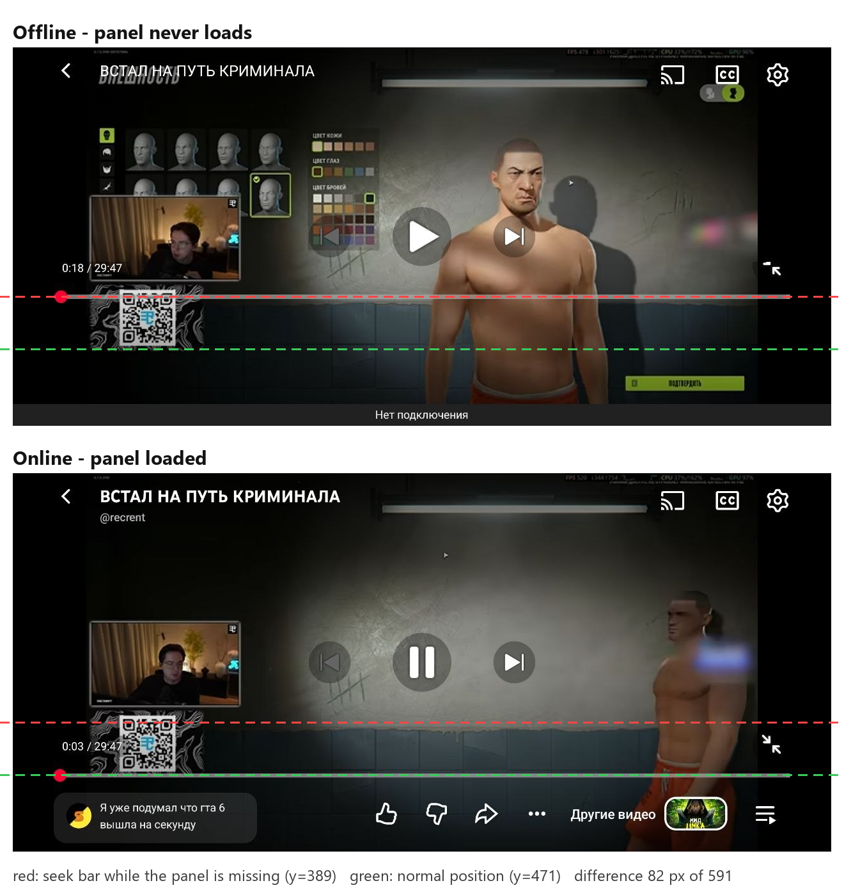
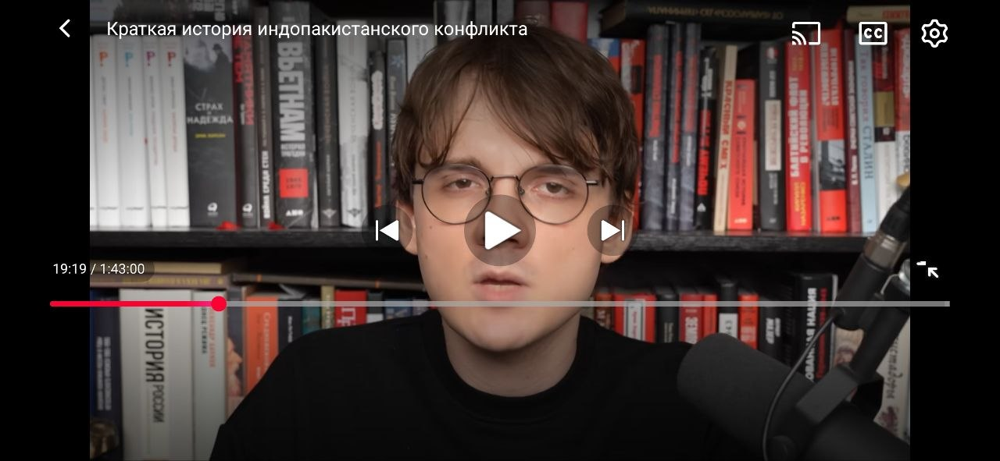
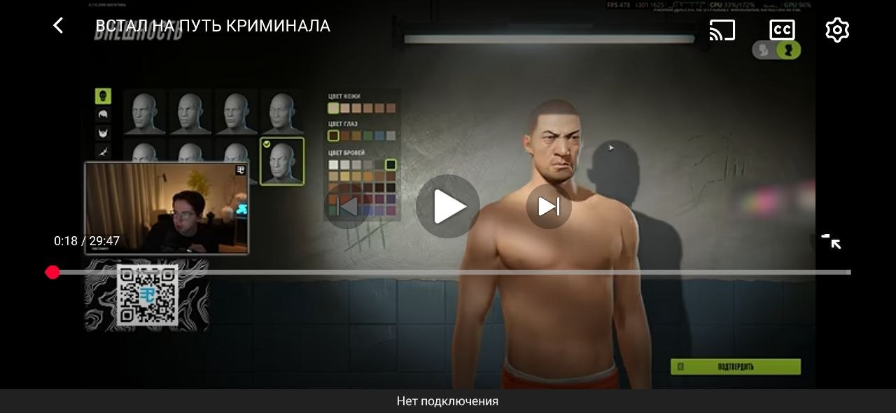
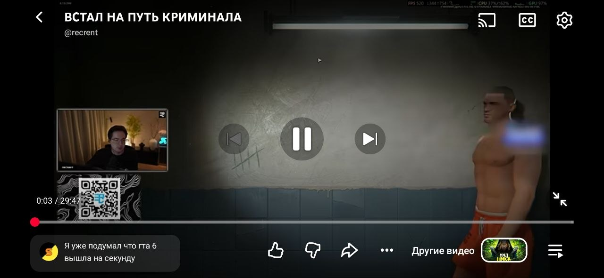
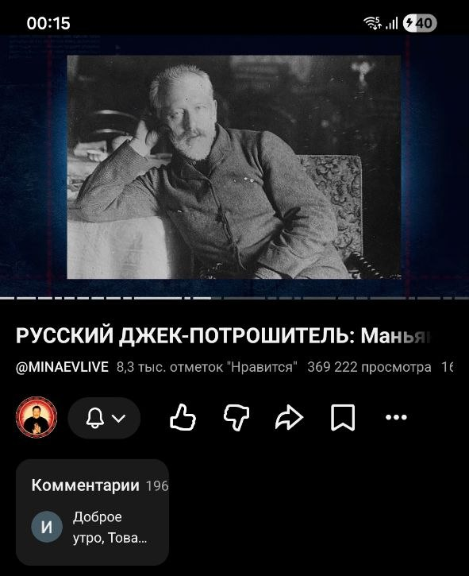
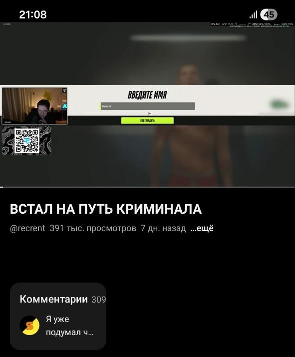

# YouTube for Android: two layout bugs

[Русская версия](README.ru.md)

Two layout bugs I found in the official YouTube Android app, reproduced, measured and reported to Google through in-app feedback on 7 November 2026.

| | |
|---|---|
| Device | Samsung Galaxy S23, Android 16 |
| App | YouTube 21.44.534, official build from Google Play, unmodified |
| Reproducibility | Every time |
| Status | Reported via in-app feedback, 2026-11-07. No reply yet |

## Bug 1. The fullscreen seek bar stays raised while the bottom panel is missing

In fullscreen, a panel sits under the seek bar: a comments preview, Like / Dislike / Share, and "More videos". Until that panel loads, the panel is missing entirely, but the seek bar and timestamp are moved **up**. They sit even higher than they do when the panel is shown. Online, they drop back once the panel arrives. Offline, the panel can never load, so the seek bar stays raised for the whole video.

### Steps to reproduce

1. Open a video and switch to fullscreen (landscape).
2. Tap the video to show the controls before the bottom panel has loaded.
3. Or play a downloaded video with no internet connection, where the bug never goes away.

**Expected:** the seek bar sits just above the bottom panel, or near the bottom edge if the panel is absent.
**Actual:** the seek bar is 82 px higher than its normal position (screenshot pixels, 1280×591). That is 14% of the screen height. The exit-fullscreen icon is drawn only partly in this state.

### Measurements

Each value is the centre of the red seek-bar track, measured on the screenshots below.

| Screenshot | State | Seek bar, y | Space below the bar |
|---|---|---|---|
| [1](images/1-fullscreen-online-loading.png) | Online, panel still loading | 389 | 202 px, empty |
| [2](images/2-fullscreen-offline.png) | Offline, panel never loads | 389 | 202 px, empty |
| [3](images/3-fullscreen-online-loaded.png) | Online, panel loaded | 471 | 120 px, panel included |

Screenshots 2 and 3 show the same video, so the content cannot explain the difference. Screenshot 1 is another video in a different session and has exactly the same offset.

### Ruling out the obvious explanation

Offline, the app shows a "No connection" strip at the bottom («Нет подключения»). That could have been the reason for the shift, but it isn't:

- the strip is about 35 px tall, and the shift is 82 px;
- screenshot 1 was taken online, without the strip, and the seek bar sits at the same y = 389.

### Likely cause

The layout seems to reserve space for the bottom panel before its data arrives, and that space is larger than the panel itself needs: 202 px versus 120 px. It is not released while loading is in progress, or when loading cannot happen at all.

  
  
  

## Bug 2. The comments preview on the watch page is squeezed to a third of the width

**Steps:** open any video in portrait mode and look at the comments preview under the title.

**Expected:** the card spans the full width and the comment fits on a line.
**Actual:** the card is about 193 px wide out of 591, a third of the screen. The comment count is pushed against the card's edge, and the text is cut off after two or three words ("Доброе утро, Това…", "Я уже подумал ч…"). The rest of the row is empty.

This happens on different videos, both online (screenshot 4) and offline (screenshot 5). Offline (screenshot 5), there is also a ~110 px empty gap above the card, where the channel / Like / Share row normally is. It looks like the same pattern as bug 1: space is kept for a block that is not there.

  
  

## How I worked

1. I noticed the raised seek bar and the narrow comments card during normal use.
2. I checked that the bugs happen in the official Google Play build, not in a modified client.
3. I reproduced the seek bar bug on two different videos and found the trigger: it lasts exactly until the bottom panel loads.
4. I isolated that trigger by going offline, where the panel can never load and the bug stays for the whole video.
5. I captured the same video in both states and measured the seek bar position by pixel colour, not by eye.
6. I ruled out the "No connection" strip as the cause by comparing with an online screenshot that doesn't have it.

---

*Not affiliated with Google or YouTube. The screenshots show third-party videos only to illustrate the app's interface.*
