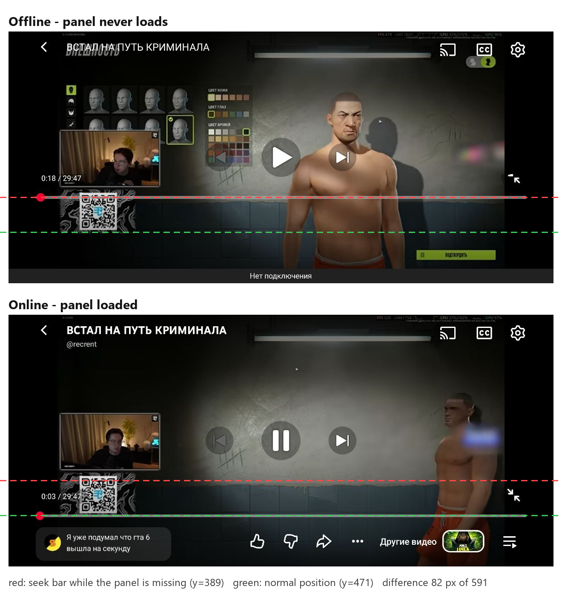
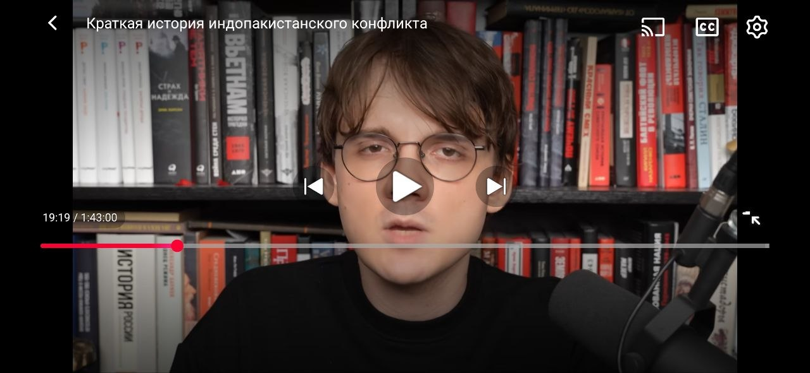
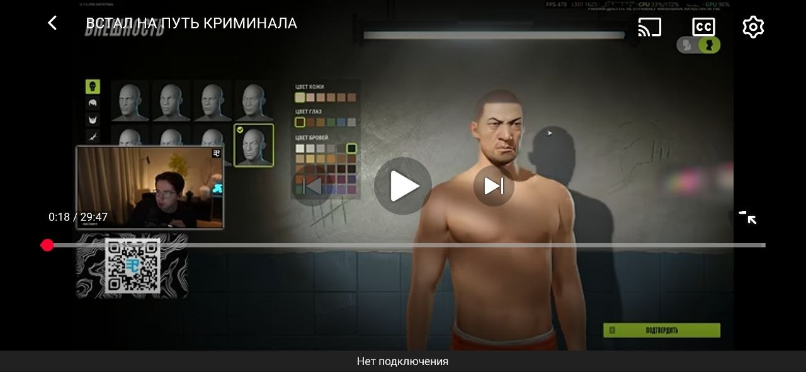
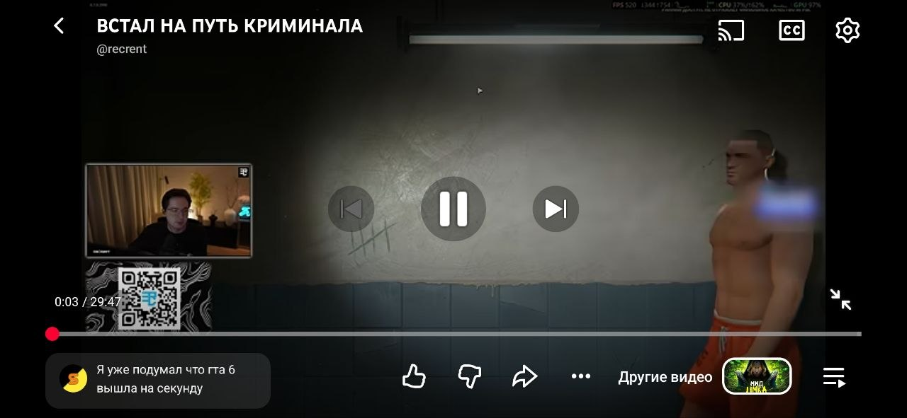
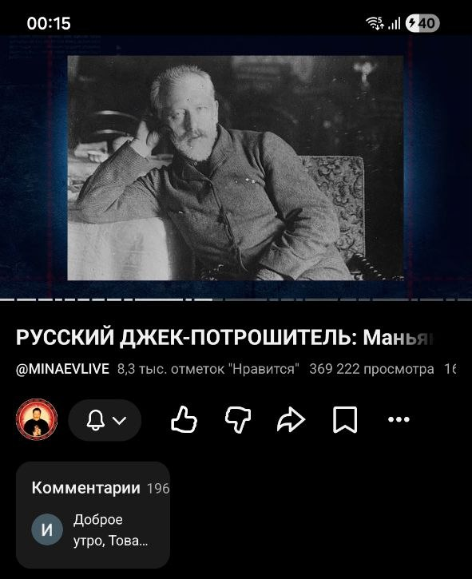
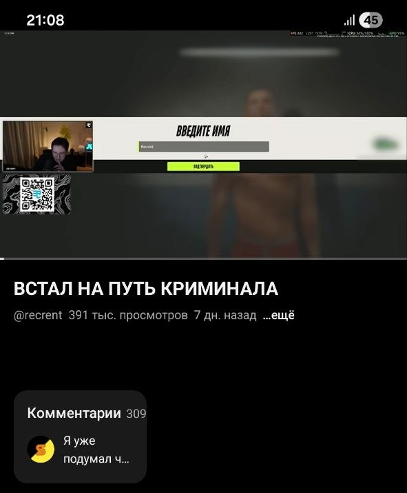

# YouTube для Android: две ошибки вёрстки

[English version](README.md)

Две ошибки вёрстки, которые я нашёл в официальном приложении YouTube для Android. Я их воспроизвёл, измерил и 7 ноября 2026 года отправил в Google через отзыв в приложении.

| | |
|---|---|
| Устройство | Samsung Galaxy S23, Android 16 |
| Приложение | YouTube 21.44.534, официальная сборка из Google Play, без изменений |
| Повторяемость | Каждый раз |
| Статус | Отправлено через отзыв в приложении 07.11.2026, ответа пока нет |

## Ошибка 1. В полноэкранном режиме шкала перемотки остаётся поднятой, пока нет нижней панели

В полноэкранном режиме под шкалой стоит панель: превью комментариев, «Нравится / Не нравится / Поделиться», «Другие видео». Пока эта панель не загрузилась, её нет на экране целиком, а шкала и время сдвинуты **вверх**, даже выше, чем при загруженной панели. Онлайн они опускаются, когда панель приходит. Офлайн панель загрузиться не может, и шкала остаётся поднятой весь просмотр.

### Как воспроизвести

1. Открыть видео и перейти в полноэкранный режим (горизонтально).
2. Нажать на видео, чтобы показать элементы управления, до загрузки нижней панели.
3. Или включить скачанное видео без интернета. Там ошибка не проходит.

**Ожидается:** шкала стоит над нижней панелью, а без панели — у нижнего края.
**На деле:** шкала на 82 px выше обычного места (в пикселях скриншота 1280×591), это 14% высоты экрана. Значок выхода из полноэкранного режима в этом состоянии отрисован не целиком.

### Замеры

Это центр красной полосы шкалы на скриншотах.

| Скриншот | Состояние | Шкала, y | Место под шкалой |
|---|---|---|---|
| [1](images/1-fullscreen-online-loading.png) | Онлайн, панель загружается | 389 | 202 px, пусто |
| [2](images/2-fullscreen-offline.png) | Офлайн, панель не загружается | 389 | 202 px, пусто |
| [3](images/3-fullscreen-online-loaded.png) | Онлайн, панель загружена | 471 | 120 px, вместе с панелью |

Скриншоты 2 и 3 сняты на одном видео, так что разница не в содержимом ролика. Скриншот 1 — другое видео и другой просмотр, а сдвиг тот же до пикселя.

### Почему это не полоса «Нет подключения»

Офлайн внизу появляется полоса «Нет подключения». Она могла бы объяснить сдвиг, но не объясняет:

- полоса высотой около 35 px, а сдвиг 82 px;
- на скриншоте 1 сеть есть и полосы нет, а шкала на том же y = 389.

### Вероятная причина

Похоже, место под нижнюю панель резервируется до загрузки данных, причём больше, чем нужно самой панели: 202 px против 120. Пока загрузка идёт или если она невозможна, это место не освобождается.

  
  
  

## Ошибка 2. Превью комментариев на странице видео сжато до трети ширины

**Как воспроизвести:** открыть любое видео вертикально и посмотреть на блок комментариев под названием.

**Ожидается:** карточка во всю ширину, комментарий виден в строку.
**На деле:** карточка шириной около 193 px из 591, треть экрана. Счётчик прижат к её краю, текст обрезан на втором-третьем слове («Доброе утро, Това…», «Я уже подумал ч…»). Остальная часть ряда пустая.

Повторяется на разных видео, онлайн (скриншот 4) и офлайн (скриншот 5). Офлайн над карточкой ещё и пустует ~110 px на месте ряда «канал / Нравится / Поделиться». Похоже на ту же закономерность, что в ошибке 1: место держится под блок, которого нет.

  
  

## Как я работал

1. Заметил поднятую шкалу и узкую карточку комментариев при обычном просмотре.
2. Проверил, что ошибки есть в официальной сборке из Google Play, а не в изменённом клиенте.
3. Повторил ошибку со шкалой на двух разных видео и нашёл, от чего она зависит: держится ровно до загрузки нижней панели.
4. Проверил это без сети: там панель не загружается никогда, и ошибка держится весь просмотр.
5. Снял одно видео в обоих состояниях и измерил положение шкалы по цвету пикселей, а не на глаз.
6. Исключил полосу «Нет подключения» как причину сравнением со скриншотом онлайн, где её нет.

---

*Проект не связан с Google и YouTube. На скриншотах чужие видео, они показаны только чтобы было видно интерфейс приложения.*
